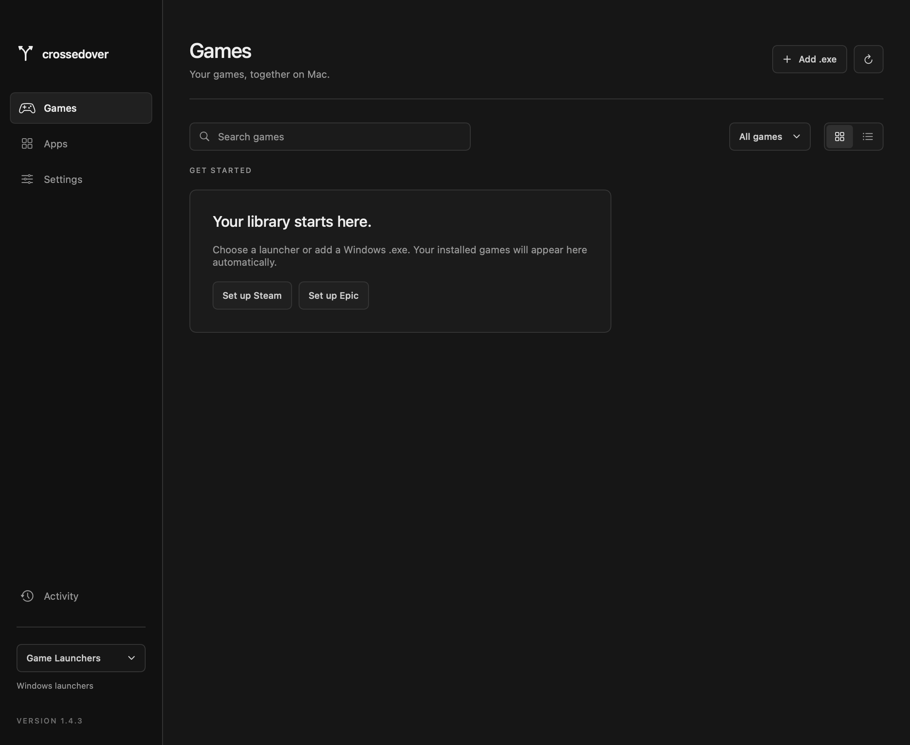

  

<h1 align="center">crossedover</h1>

Windows apps and games, at home on your Mac.

  <a href="https://corypearl.github.io/crossedover/"><strong>Website ↗</strong></a>
  &nbsp;·&nbsp;
  <a href="https://github.com/CoryPearl/crossedover/releases">Downloads</a>
  &nbsp;·&nbsp;
  <a href="QUICKSTART.md">Quickstart</a>
  &nbsp;·&nbsp;
  <a href="TECHNICAL_README.md">Technical README</a>

v1.3.0 &nbsp;·&nbsp; macOS &nbsp;·&nbsp; Apple silicon &nbsp;·&nbsp; Open source

 

  
   
  A little less launcher. A little more library. Interface preview · v1.3.0.

Run Windows software on your Mac through Wine. **Games** for what you play. **Apps** for everything else. Steam games are our focus, with Epic Games and Ubisoft Connect handoffs alongside them. More launcher and platform support is coming soon.

| Your games, together | Bring an .exe | Stay in control |
| --- | --- | --- |
| Steam and Epic installs in one searchable library. Open your clients from **Game Launchers**. | Add Windows games, tools, installers, and mod managers as cards. Steam is optional. | See launch status, stop Windows windows, browse files, and manage your installations. |

## Get started

1. Open the DMG and drag **crossedover** into **Applications**.
2. Open **Game Launchers** in the sidebar and choose **Set up Steam** or **Set up Epic Games**, sign in inside that launcher, and install a Windows game. Completed installs appear in **Games** automatically.
3. For other software, choose **Add .exe**, pick **Games** or **Apps**, and add the card. Press **Play** or **Run** whenever you need it. Both launchers are optional for imported apps.

**Required:** Apple silicon (M1 or newer), macOS 15 or 26, working Rosetta, and **8 GiB free plus app/game storage**. **Recommended:** M4-class performance, **16 GB+ unified memory** (24–32 GB+ for heavier games), and an SSD with room for updates. These are guidelines, not a 60 FPS guarantee. [Hardware guidelines](docs/HARDWARE.md) · [Quickstart](QUICKSTART.md). This release is not notarized.

Use **Game Launchers** to open Steam, Epic Games, or an installed Ubisoft Connect client, filter Games by store, search either library, and switch between grid and list views. Include an app’s containing folder when it needs nearby files. After running an installer, use the card’s **⋯ → Edit app / choose executable** to select the installed program. Files stay local; nothing is uploaded. Only add software you trust: Windows apps run with your Mac user permissions.

Compatibility varies. TrackMania Nations Forever is our first tested game; CS2 is experimental. Importing an executable does not guarantee it will work. Drivers, anti-cheat, extra frameworks, and some apps need functionality this runtime does not provide.

The bottom launch bar shows opening and running status. **Stop & close Windows** cancels the launch and closes all managed Windows windows; unsaved progress may be lost.

Use **⋯** to manage cards and browse files. Steam keeps its uninstall and verification controls. Epic cards open **Epic Library → ⋯ → Manage** for verification and uninstall; confirm there. Both stores have file access, launch tracking, and mod folders. Imported cards can be renamed, moved between libraries, or removed. Removing an imported card keeps its files. [Mods and file access](QUICKSTART.md#mods) use normal Windows locations.

Full environment backups are **manual only**. **Settings → Uninstall crossedover** removes the app, managed Windows apps, games, saves, and data after Windows software is closed. Empty Trash afterward. Dragging only the Mac app to Trash leaves its separate data folder behind.

Epic’s launcher uses Metal for DirectX 10–11; DirectX 9 games use Performance rendering when available. Steam and imported apps keep their selected graphics profile. See the [Epic quickstart](QUICKSTART.md#epic-games) for setup and management.

The Windows Xbox app and Minecraft Bedrock are **not supported by the included runtime**. Settings can open Xbox Cloud Gaming for supported streaming titles; this does not install Xbox games. [Xbox and Bedrock status](QUICKSTART.md#xbox-and-minecraft-bedrock).

## Build

Read the [Technical README](TECHNICAL_README.md) for an in-depth explanation of the architecture, Windows runtime, launchers, graphics, storage, recovery, and release process.

~~~sh
swift test
python3 scripts/package.py --thin --dmg
~~~

This makes a developer app without a Windows runtime. See [development](docs/DEVELOPMENT.md), [runtime builds](docs/RUNTIME.md), and [website source](website/README.md).

[GPL-3.0-or-later](LICENSE) · [Third-party notices](THIRD_PARTY_NOTICES.md) · [Validation](docs/VALIDATION.md)

An independent project, unaffiliated with Valve, Epic Games, CodeWeavers, or Apple.
